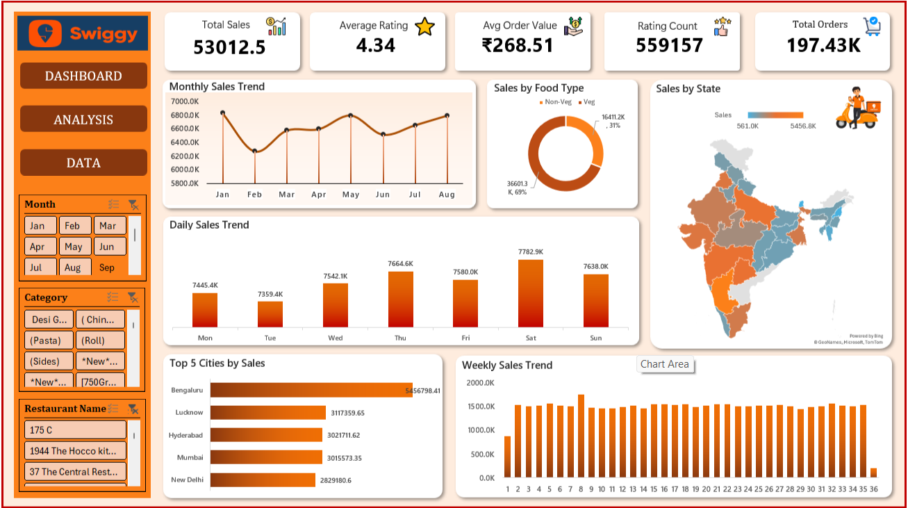

🍔 Swiggy Sales Analysis Dashboard (Excel)
1. Project Title
Swiggy Sales Analysis Dashboard – Interactive Excel Dashboard using Pivot Tables, Pivot Charts & Slicers
---
2. Project Overview
This project analyses food-delivery listing data from Swiggy across 28 Indian states and cities, covering January 2025 to August 2025.
The raw dataset has 197,430 records from 993 restaurants, with details such as state, city, order date, restaurant, category, dish, food type (Veg / Non-Veg), price, rating and rating count.
The data was cleaned and summarised with Pivot Tables and presented as an interactive one-page Excel dashboard with KPI cards, charts and slicers.
---
3. Project Objective
Track overall sales performance with a few clear KPIs.
Find the top-performing states and cities.
Understand sales trends by month, week and day.
Compare Veg vs Non-Veg sales.
Find the leading restaurants and categories.
Let users filter the dashboard by Month, Restaurant and Category using slicers.
---
4. Tools & Technologies Used
Tool / Feature	Purpose
Microsoft Excel	Data analysis and dashboard building
Excel Tables	Structured raw data
Pivot Tables	Summarising data (7 pivots)
Pivot Charts	Line, column, bar and doughnut charts
Map Chart (Filled Map)	State-wise sales visualisation
Slicers	Interactive filters (Month, Restaurant, Category)
Shapes, Icons & Hyperlinks	Dashboard layout and navigation between sheets
---
5. Key Performance Indicators (KPIs)
KPI	Value
💰 Total Sales	₹53.01 M (₹53,012.5 K)
🧾 Total Orders	197.43 K
🛒 Average Order Value	₹268.51
⭐ Average Rating	4.34
🗳️ Total Rating Count	5,591,574
---
6. Dashboard Features
5 KPI cards at the top: Total Sales, Total Orders, Avg Order Value, Average Rating, Rating Count.
Monthly Sales Trend – line chart.
Weekly Sales Trend – column chart.
Daily Sales Trend – column chart (by day of week).
Sales by Food Type – doughnut chart (Veg vs Non-Veg).
Top 5 Cities by Sales – bar chart.
Sales by State – map chart.
Interactive slicers for Month, Restaurant Name and Category.
Navigation buttons to move between the Dashboard, Analysis and Data sheets.
Clean, gridline-free layout with a consistent colour theme.
---
7. Key Insights
💰 Total sales are ₹53.01 M from 197,430 orders, with an average order value of about ₹268.5.
📍 Bengaluru (Karnataka) is the top city and state with ₹5.46 M (10.3%) of total sales.
🏙️ The top 5 cities (Bengaluru, Lucknow, Hyderabad, Mumbai, New Delhi) together make up about 33% of total sales.
🥗 Veg items drive 67.4% of sales (₹35.72 M); Non-Veg contributes 32.6% (₹17.30 M).
🍗 KFC leads all restaurants with ₹4.25 M (8.0%), followed by McDonald's (₹3.34 M) and Pizza Hut (₹2.13 M).
📅 Monthly sales are fairly stable at ₹6.3 M – ₹6.8 M. January is the highest (₹6.83 M) and February the lowest (₹6.27 M), partly because it is a shorter month.
🗓️ Saturday is the strongest day (₹7.78 M) and Tuesday the weakest (₹7.36 M), though the gap between days is small.
⭐ The average rating of 4.34 suggests generally high customer satisfaction.
---
8. Dashboard Preview
](MY_DASHBOARD.xlsx)
Click the image to open the Excel file.
---
9. Excel File
📂 Download the Excel Dashboard
The workbook has 4 sheets:
Sheet	Description
`Swiggy Data`	Raw dataset (197,430 rows, 13 columns)
`Detail1`	Supporting detail table
`Analysis`	Pivot tables and pivot charts
`Dasboard`	Final interactive dashboard
> Open the file in **Microsoft Excel (desktop)** so that slicers, pivot charts and the map chart work correctly.
---
10. Skills Demonstrated
Data cleaning and data preparation in Excel
Pivot Tables and Pivot Charts
Dashboard design and data visualisation
KPI creation and business metrics
Slicers and interactive filtering
Trend analysis (monthly, weekly, daily)
Geographic analysis with Map Charts
Data storytelling and insight generation
Documentation of an analytics project
---
⭐ If you found this project useful, feel free to star the repository!
